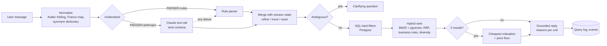

# Bilingual Conversational Property Search

Buyers in Egypt search the way they talk: *"3 غرف في التجمع تحت 8 مليون تقسيط 8 سنين"*, *"3ayez sha2a fel tagamo3 ta7t 7 mlyon"*, *"villa in Zayed, ready to move, garden"*. Filter forms fail on Egyptian Arabic, Franco-Arabic and vague wishes.

This service turns one chat message (Arabic, Franco-Arabic, English or mixed) into validated filters plus soft preferences. It retrieves and ranks matching units, explains why each one fits, asks a question when the query is ambiguous, and relaxes filters with an explanation when nothing matches. Follow-ups like "cheaper", "more" or "with a garden" refine the same session.

Every price, size and unit code in a reply comes from the database. No model ever writes a number.

## How a turn works



| Stage | Where | What it does |
|---|---|---|
| Normalise | `normalize.py`, `data/synonyms.yaml` | Folds Arabic letter variants, maps Franco-Arabic, tags areas, types, amenities, money and numbers |
| Understand | `understanding/rules.py`, `understanding/llm.py` | Message to `SearchFilters` (Pydantic). Claude path uses tool calling with a strict schema and falls back to rules on any error |
| Session | `pipeline.py` | Stores the parsed state per session, so "cheaper" lowers the budget 10% under the last results' median price |
| Retrieve | `retrieval/sql.py` | Each filter is one SQL predicate. Payment-plan filters must hold on the same plan |
| Rank | `retrieval/ranker.py` | Reciprocal rank fusion of BM25 and pgvector over unit descriptions, then availability and freshness rules and a per-compound diversity cap |
| Relax | `retrieval/relax.py` | Finds the cheapest change that unlocks units (budget +10%, nearby area, sibling type, ...). Reports which constraints are binding |
| Respond | `respond.py` | Template reply in the user's language, reasons per unit, follow-up suggestions. Optional Claude narrative, checked against DB fields |
| Monitor | `insights.py`, `/api/insights` | Zero-result rate, binding constraints, unknown terms, language mix, latency and cost |

## Results

`python scripts/eval.py` runs 32 labelled queries (10 Arabic, 8 Franco, 10 English, 4 mixed) through the full turn on Postgres. Results are in `evals/results/rules.json`.

| Metric | Rules parser |
|---|---|
| Filter exact match | 1.00 (32/32) |
| Field micro F1 | 1.00 |
| Clarification accuracy | 1.00 |
| Zero-result rate after relaxation | 0.031 (1 query: a villa under 2M has no match at any relaxation; the reply gives the price floor) |
| Turn latency p50 / p95 | 9 ms / 12 ms (hashing embedder, no reranker, laptop) |

The first run scored 0.969 because "shale" (Franco for chalet) was missing from the dictionary. That one gap is fixed.

The set is small and written next to the dictionary, so it works as a regression gate (CI fails under 0.9), not as proof of coverage on real traffic. The Claude parser path (`--parser anthropic`) is built and tested for fallback, but it hasn't been scored yet because no API key was available.

## Run it

You need Python 3.11+ and Postgres with pgvector.

```bash
docker compose up --build
```

The API is on http://localhost:8000. Swagger is at `/docs`. The synthetic inventory (14 developers, 45 compounds, 1,492 units) is seeded on first start.

Without Docker:

```bash
pip install -e ".[dev,localdb]"
```

```bash
pytest -q
```

Tests start an embedded Postgres with pgvector (`pgserver`) unless `TEST_DATABASE_URL` is set.

```bash
python scripts/eval.py
```

Example request:

```bash
curl -s localhost:8000/api/search -H "content-type: application/json" -d '{"message": "3ayez sha2a fel tagamo3 ta7t 7 mlyon w mo2adam 10%"}'
```

Send the returned `session_id` with the next message to refine ("cheaper", "more", "with a garden", "new search").

## API

| Method | Path | Purpose |
|---|---|---|
| POST | `/api/search` | One chat turn: `{message, session_id?}` returns filters, units, reasons, clarification, relaxations, suggestions |
| GET | `/api/units/{id}` | Unit detail with compound, developer on-time rate and payment plans |
| POST | `/api/events` | Click or inquiry on a shown unit (implicit relevance label). The turn must belong to the session |
| GET | `/api/insights` | Monitoring aggregates over the query log |
| GET | `/api/meta`, `/api/health` | Areas, landmarks, examples; health and active models |

## Configuration

See `.env.example`.

| Variable | Default | Options |
|---|---|---|
| `PARSER` | `rules` | `anthropic` (Claude tool calling, needs `ANTHROPIC_API_KEY`) |
| `EMBEDDER` | `hashing` | `bge-m3` (downloads the model; `pip install -e ".[ml]"`) |
| `RERANKER` | `none` | `bge` (bge-reranker-v2-m3 cross-encoder) |
| `LLM_SUMMARY` | `false` | Adds a Claude narrative under the template reply |
| `LANGFUSE_*` | empty | Traces each turn (understand, retrieve) when set |

## Stack

Python, FastAPI, Pydantic, SQLAlchemy, PostgreSQL + pgvector, rank-bm25, sentence-transformers (bge-m3, bge-reranker-v2-m3), Anthropic SDK (tool calling), camel-tools (optional), Langfuse, pytest, ruff, Docker, GitHub Actions.

## Design choices

- **SQL for hard filters, hybrid search for soft wishes.** Budgets, bedrooms and unit codes are exact; "quiet, good for families" is not. Pure vector search would miss numbers and compound names.
- **Rules first, LLM optional.** The rule parser is free, fast and deterministic, and it covers the labelled set. Claude is used when it's enabled and falls back to rules on any failure, so search never goes down because of a model.
- **No generated facts.** Replies are built from DB fields. The optional narrative is checked against those fields before it's shown.
- **Explain, don't hide, empty results.** Relaxation says what was changed and how many units it unlocked; binding constraints are logged as unmet demand.

## Data

All inventory is synthetic (`data/generate.py`, fixed seed). Developer, compound and unit names are fictional.

## Not built yet

- Chat web UI (Next.js, RTL). The API is complete; the UI is the next piece.
- Scored Claude parser run and bge-m3 / reranker retrieval comparison (NDCG@10, recall@20) on a larger labelled set.
- Deployment (Render for API + Postgres).

## License

MIT
