# Bilingual Conversational Property Search

Buyers in Egypt search the way they talk: *"3 غرف في التجمع تحت 8 مليون تقسيط 8 سنين"*, *"3ayez sha2a fel tagamo3 ta7t 7 mlyon"*, *"villa in Zayed, ready to move, garden"*. Filter forms fail on Egyptian Arabic, Franco-Arabic and vague wishes.

This service turns one chat message (Arabic, Franco-Arabic, English or mixed) into validated filters plus soft preferences. It retrieves and ranks matching units, explains why each one fits, asks a question when the query is ambiguous, and relaxes filters with an explanation when nothing matches. Follow-ups like "cheaper", "more" or "with a garden" refine the same session.

Every price, size and unit code in a reply comes from the database. No model ever writes a number.

<p align="center"></p>

**Live demo:** https://conversational-property-search.vercel.app (synthetic inventory, not real listings). API: https://propsearch-api.vercel.app/docs

## How a turn works

```mermaid
flowchart LR
    Q[User message] --> N[Normalise<br/>Arabic folding, Franco map,<br/>synonym dictionary]
    N --> U{Understand}
    U -->|PARSER=rules| R[Rule parser]
    U -->|PARSER=anthropic / llm| C[LLM tool call<br/>Claude, Groq, OpenRouter]
    C -.any failure.-> R
    R --> M[Merge with session state<br/>refine / more / reset]
    C --> M
    M --> A{Ambiguous?}
    A -->|yes| CL[Clarifying question]
    A -->|no| S[SQL hard filters<br/>Postgres]
    S --> H[Hybrid rank<br/>BM25 + pgvector, RRF,<br/>business rules, diversity]
    H --> Z{0 results?}
    Z -->|yes| RX[Cheapest relaxation<br/>+ price floor]
    Z -->|no| RE[Grounded reply<br/>reasons per unit]
    RX --> RE
    RE --> L[(Query log, events)]
```



| Stage | Where | What it does |
|---|---|---|
| Normalise | `normalize.py`, `data/synonyms.yaml` | Folds Arabic letter variants, maps Franco-Arabic, tags areas, types, amenities, money and numbers |
| Understand | `understanding/rules.py`, `understanding/llm.py` | Message to `SearchFilters` (Pydantic). Claude path uses tool calling with a strict schema and falls back to rules on any error |
| Session | `pipeline.py` | Stores the parsed state per session, so "cheaper" lowers the budget 10% under the last results' median price |
| Retrieve | `retrieval/sql.py` | Each filter is one SQL predicate. Payment-plan filters must hold on the same plan |
| Rank | `retrieval/ranker.py` | Reciprocal rank fusion of BM25 and pgvector over unit descriptions, then availability and freshness rules and a per-compound diversity cap |
| Relax | `retrieval/relax.py` | Finds the cheapest change that unlocks units (budget +10%, nearby area, sibling type, ...). Reports which constraints are binding |
| Respond | `respond.py` | Template reply in the user's language, reasons per unit, follow-up suggestions. Optional Claude narrative, checked against DB fields |
| Monitor | `insights.py`, `/api/insights` | Zero-result rate, binding constraints, unknown terms, language mix, latency and cost |

## Results

Two labelled sets, scored through the full turn on Postgres with `python scripts/eval.py` (results in `evals/results/`):

- **Dev set** (`evals/queries.jsonl`, 32 queries: 10 Arabic, 8 Franco, 10 English, 4 mixed). Written next to the dictionary, so it is a regression gate (CI fails under 0.9).
- **Held-out set** (`evals/heldout.jsonl`, 24 queries). Phrasings the dictionary was not built for: "Fifth Settlement", "keys now", "25 million tops", "no more than 15% upfront", "تلات أوض", "odten". Labelled before any parser was run on it.

| Parser | Dev exact match | Held-out exact match | LLM calls | LLM latency p50 | Cost / query |
|---|---|---|---|---|---|
| Rules only | **1.00** | 0.71 | 0 | — | $0 |
| Groq `gpt-oss-120b`, every turn | 0.94 | **0.92** | 100% | ~0.9-1.3 s | ~$0.0005-0.0006 |
| Groq `gpt-oss-120b`, gated (deployed) | **1.00** | **0.92** | 3% dev, 42% held-out | ~1.0 s | ~$0.00002-0.00025 |
| Groq `gpt-oss-20b`, every turn | — | 0.83 | 100% | ~1.0 s | ~$0.0003 |

**Gated** means rules first, and the LLM only sees a message when the rules leave a term unread (`LLM_MODE=on_unknown`). It keeps the rules' exact handling of what the dictionary knows, and adds the LLM where the dictionary has a gap. On the held-out set it sent 10 of 24 messages to Groq; on the dev set, 1 of 32. Most turns stay at ~10 ms and the free tier's 8k tokens per minute goes much further.

Notes:
- Field micro F1 for the gated parser: 1.00 dev, 0.98 held-out. Clarification accuracy 1.00 on both.
- Remaining held-out misses: "two-bed" (rules drop it silently, so the gate never fires) and "a pool of its own" read as a shared pool. Both are known gaps, kept in the set on purpose rather than patched into the dictionary.
- `qwen/qwen3.8-27b` was tried and dropped: it called a tool that does not exist on 46% of turns (each one fell back to rules).
- The gpt-oss-20b dev run hit the free-tier quota on every call, so it has no dev number. The every-turn gpt-oss-120b dev run also fell back to rules on 16% of turns (cause not logged in that run); its two misses (dropped area, dropped garden on Franco queries) are model misses.
- Rules-only turn latency is 9 ms p50 / 12 ms p95 (hashing embedder, no reranker, laptop). Zero-result rate after relaxation is 0.031 on dev: a villa under 2M has no match at any relaxation, so the reply gives the price floor.
- When an LLM call fails (rate limit, timeout, invalid tool arguments), that turn uses the rule parser. Search never goes down because of a model.
- Groundedness is 1.00 on both sets (`grounded_turn_rate`): every unit field in a reply equals its DB row, every payment plan exists, and every number in the message and the reasons traces to the DB, the user's own filters or arithmetic on them (gap to budget, rounded distance). It's a deterministic check, so it replaces an LLM-judged faithfulness score such as Ragas.

### Ranking quality on soft wishes (labelled pool)

`evals/retrieval.jsonl` has 30 soft-wish queries ("quiet street", "close to international schools", "فيها اضاءة طبيعية", "sha2a fel tagamo3 hadya") in English, Arabic, Franco and mixed. Each query's SQL candidate set is the pool. A unit is relevant when its hidden generator tags (written into the description as paraphrases and never stored in the DB) include the query's tags. Because every relevant unit in the pool is known, recall is measurable, which click logs can't give. `python scripts/retrieval_eval.py` scores the final ranked list (relevance plus business rules) with ranx; superscripts mark a significant win (paired t-test, p < 0.05) over the lettered row. 29 queries are scored; one has no relevant unit in its pool.

| | Ranking | NDCG@10 | Recall@20 | MRR |
|---|---|---|---|---|
| a | BM25 | 0.760ᶜ | 0.673ᵇ | 0.903ᶜ |
| b | BM25 + hashing vectors (previous deploy) | 0.738 | 0.657 | 0.886ᶜ |
| c | bge-m3 vectors only | 0.673 | 0.620 | 0.788 |
| d | BM25 + bge-m3 (RRF) | **0.784**ᶜ | 0.672ᶜ | 0.852ᶜ |
| e | BM25 + bge-m3 + bge-reranker-v2-m3 | 0.745 | 0.643 | 0.880 |
| f | BM25 + bge-m3, precomputed (deployed) | 0.777ᶜ | 0.670 | 0.852ᶜ |
| g | f + precomputed reranker | 0.742 | 0.649 | 0.880 |

What it says:
- **bge-m3 helps only inside the hybrid.** On its own it's the weakest row. Fused with BM25 it's the best (+0.046 NDCG@10 over the previous deploy), with the clearest gains on "natural light" (0.56 to 0.80), "pet friendly" (0.78 to 1.0) and "family friendly".
- **The cross-encoder hurts here,** so it is off. It drops compound wishes ("quiet; family friendly" 0.89 to 0.55) and "good for rental investment" (1.0 to 0.52), because it scores a short phrase against a whole bilingual listing. Its scores are still stored and used for one job: picking the description sentence quoted as evidence under each unit.
- **BM25 is strong because the parsers canonicalise wishes** to fixed phrases ("hadya" and "هادي" both become "quiet calm area"). With that, the gap between rankers is small, and only bge-m3 vectors alone are significantly worse.
- **Three queries score 0 with every ranker** because the rules don't read the wish at all ("walking distance of shops", "eda2a tabe3eya", "ard"). That's a dictionary gap, not a ranking one. The gated LLM parser covers those phrasings live.
- "Precomputed" (row f) is what serves: the 0.007 loss against row d is from averaging per-phrase vectors for compound wishes instead of embedding the joined text.

The pool also caught a parser bug: Franco "mn" ("from", as in "2orayeba mn el madares") was read as "1 million" and filtered every villa out. Fixed, with a regression test.

### Ranking quality from clicks (annotator pilot)

`scripts/click_metrics.py` turns logged events into graded labels (inquiry = 2, Details click = 1) over the ranked list each turn showed (`query_log.top_unit_ids`), then reports NDCG@10, MRR and engagement rates. Only shown units can be judged, so recall needs a separate labelled pool.

**There is no real user traffic yet.** To exercise the loop end to end, one annotator (Claude, driving Chrome on the live site) ran 7 sessions as different buyers: a family in New Cairo, an investor in the New Capital, a Franco-Arabic chalet buyer, a villa buyer who had to pick between the two Zayeds, a quiet-apartment seeker near AUC, a first-time buyer on a tight budget, and a townhouse buyer. Each one opened the units that fit their request and inquired on the best one. These are one judge's labels, not market behaviour (`evals/results/clicks-annotator-pilot.json`).

| Metric | Value |
|---|---|
| Ranked turns / turns with interaction | 11 / 9 |
| NDCG@10 | 0.75 |
| MRR | 0.64 |
| Abandonment | 18% |
| Turns ending in an inquiry | 82% |

The weakest turns (NDCG about 0.52) were soft wishes: "big garden" ranked 90 m² gardens above 500 m² ones, and "quiet" ranked pet-friendly units first. The labelled pool above measures the second kind and moved the deploy to BM25 + bge-m3. "Big garden" is a size, not a meaning: no embedder orders 90 vs 500 m², so it needs a garden-size preference in the parser (open).

The pilot also found five bugs, all fixed with regression tests where they apply:
- After a +10% budget relaxation, a unit above the user's budget was described as "under your budget". The reason now compares with the budget the user asked for and says "over your budget".
- "mesh lazem 3al ba7r" (doesn't have to be on the beach) added the beach constraint when the LLM call was rate-limited. The rules now understand removal ("mesh lazem", "not necessarily", "without", "مش لازم", "بدون").
- Picking an area in a clarification switched an Arabic conversation to English. The chip now sends the Arabic name.
- "New search" ran an empty search (1,410 units) instead of starting over. It now resets the chat.
- The example chips were missing on a cold start because the first `/api/meta` call failed. The page now retries and shows built-in examples meanwhile.

## Run it

You need Python 3.11+ and Postgres with pgvector.

```bash
docker compose up --build
```

The chat UI is on http://localhost:3000 and the API on http://localhost:8000 (Swagger at `/docs`). The synthetic inventory (14 developers, 45 compounds, 1,492 units) is seeded on first start.

Without Docker:

```bash
pip install -e ".[dev,localdb]"
```

```bash
pytest -q
```

Tests start an embedded Postgres with pgvector (`pgserver`) unless `TEST_DATABASE_URL` is set.

```bash
python scripts/eval.py
```

Example request:

```bash
curl -s localhost:8000/api/search -H "content-type: application/json" -d '{"message": "3ayez sha2a fel tagamo3 ta7t 7 mlyon w mo2adam 10%"}'
```

Send the returned `session_id` with the next message to refine ("cheaper", "more", "with a garden", "new search").

Web UI without Docker (API running on :8000):

```bash
cd frontend
npm ci
npm run dev
```

## Web UI

Next.js chat in `frontend/`. The browser only calls same-origin `/api/*`; Next rewrites it to the FastAPI service (`API_URL`), so there is no CORS setup and the backend address never ships to the client.

- Arabic replies render right-to-left, English left-to-right, chosen per turn from `reply_language`.
- Each turn shows what was understood as filter pills, so a wrong parse is visible at once.
- Unit cards show price, price per m², best payment plan and the match reasons from the API. Details opens payment plans and the developer's on-time record.
- Clarification options and follow-up suggestions are one-tap chips.
- Details and Inquire clicks are posted to `/api/events` as implicit relevance labels.
- `/insights` shows the monitoring view: KPIs, demand vs supply by area, unmet demand, synonym review queue, language mix, latency by stage.

## End-to-end tests

Playwright drives the real stack (UI, API, Postgres) on desktop and mobile viewports: Arabic RTL search, English and Franco-Arabic parsing, clarification, follow-up refinement, impossible queries, unit details and inquiry, and the insights page. 16/16 pass.

```bash
docker compose up -d --build --wait
cd frontend && npx playwright install chromium && npx playwright test
```

The README demo is scripted in `docs/demo/scene.py` (Playwright) so it can be re-recorded when the UI changes.

Point it at a deployment with `E2E_BASE_URL=https://... npx playwright test`. CI runs it on every push after the unit tests and the eval gate.

## Deploy

The live demo runs on free tiers with no card: two Vercel projects and a Neon Postgres (pgvector).

- **API:** Vercel Python function. `api/index.py` wraps the FastAPI app, `vercel.json` routes every path to it, and `requirements.txt` holds the runtime deps. The app sets itself up on the first request because serverless runtimes may skip ASGI lifespan.
- **Database:** Neon via the Vercel marketplace (`vercel integration add neon`), which injects `DATABASE_URL`. Seed it once from any machine: `DATABASE_URL=<neon direct url> python -m propsearch.seed`.
- **Models without a model server:** bge-m3 doesn't fit a serverless function, and hosted inference isn't free. But the parsers emit soft wishes from a closed set of 20 phrases, so every model output a turn can need is known in advance. On a machine with the models (`pip install -e ".[ml]"`, GPU optional), `python -m propsearch.seed --embedder bge-m3` writes the unit vectors and `python -m propsearch.retrieval.precomputed` writes the 20 phrase vectors plus 36k cross-encoder scores (phrase × listing and phrase × description sentence). The API runs with `EMBEDDER=bge-m3 EMBED_DEVICE=precomputed`, so a turn's vector stage is one pgvector query (~10 ms). LLM free text such as "near international schools" is mapped onto the phrases through the synonym dictionary. Anything unmapped ranks with BM25 for that turn. Outputs are cached on disk by content hash, so loading the same inventory into another database takes seconds. Rerun both commands when the inventory changes.
- **Web:** Vercel project with root directory `frontend` and `API_URL=https://<api-project>.vercel.app`.
- **Containers:** the same API image runs anywhere Docker does. `render.yaml` is a Render Blueprint for it, but Render requires a card even on the free plan.

The Playwright suite runs against production too: 16/16 pass on https://conversational-property-search.vercel.app.

## API

| Method | Path | Purpose |
|---|---|---|
| POST | `/api/search` | One chat turn: `{message, session_id?}` returns filters, units, reasons, clarification, relaxations, suggestions |
| GET | `/api/units/{id}` | Unit detail with compound, developer on-time rate and payment plans |
| POST | `/api/events` | Click or inquiry on a shown unit (implicit relevance label). The turn must belong to the session |
| GET | `/api/insights` | Monitoring aggregates over the query log |
| GET | `/api/meta`, `/api/health` | Areas, landmarks, examples; health and active models |

## Configuration

See `.env.example`.

| Variable | Default | Options |
|---|---|---|
| `PARSER` | `rules` | `llm` (any OpenAI-compatible API: Groq, OpenRouter; needs `LLM_API_KEY`), `anthropic` (Claude, needs `ANTHROPIC_API_KEY`) |
| `LLM_BASE_URL` | Groq | e.g. `https://openrouter.ai/api/v1` |
| `LLM_MODEL` | `openai/gpt-oss-120b` | any tool-calling model on that endpoint |
| `LLM_MODE` | `on_unknown` | `always` (LLM on every turn) |
| `EMBEDDER` | `hashing` | `bge-m3` (downloads the model; `pip install -e ".[ml]"`) |
| `RERANKER` | `none` | `bge` (bge-reranker-v2-m3 cross-encoder; measured worse on the labelled pool, see Results) |
| `EMBED_DEVICE` | `cpu` | `cuda` (fp16), `precomputed` (model outputs read from Postgres, deployed), `hf` (Hugging Face Inference, `HF_TOKEN`, needs paid credits) |
| `LLM_SUMMARY` | `false` | Adds a Claude narrative under the template reply |
| `LANGFUSE_*` | empty | Traces each turn (understand, retrieve) when set |

## Stack

Python, FastAPI, Pydantic, SQLAlchemy, PostgreSQL + pgvector, rank-bm25, sentence-transformers (bge-m3, bge-reranker-v2-m3), Anthropic SDK (tool calling), camel-tools (optional), Langfuse, ranx, Next.js, TypeScript, Playwright, pytest, ruff, Docker, GitHub Actions, Render, Vercel.

## Design choices

- **SQL for hard filters, hybrid search for soft wishes.** Budgets, bedrooms and unit codes are exact; "quiet, good for families" is not. Pure vector search would miss numbers and compound names.
- **Rules first, LLM optional.** The rule parser is free, fast and deterministic, and it covers the labelled set. Claude is used when it's enabled and falls back to rules on any failure, so search never goes down because of a model.
- **No generated facts.** Replies are built from DB fields. The optional narrative is checked against those fields before it's shown.
- **Precompute instead of serving models.** A closed set of wishes turns a GPU at query time into a table lookup. If a model call does fail (remote timeout, unmapped wish), that stage is skipped and the turn ranks with BM25.
- **Explain, don't hide, empty results.** Relaxation says what was changed and how many units it unlocked; binding constraints are logged as unmet demand.

## Data

All inventory is synthetic (`data/generate.py`, fixed seed). Developer, compound and unit names are fictional.

## Not built yet

- Scored Claude parser run (built and tested for fallback; no Anthropic API key).
- Ranking metrics on real traffic. `scripts/click_metrics.py` is ready; it needs real users instead of the annotator pilot above.
- A garden-size preference ("big garden"), and soft wishes the rules can't read yet (see the three zero rows above).

## License

MIT
